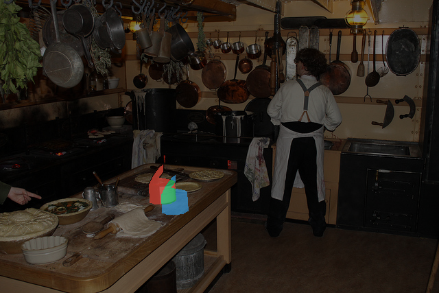
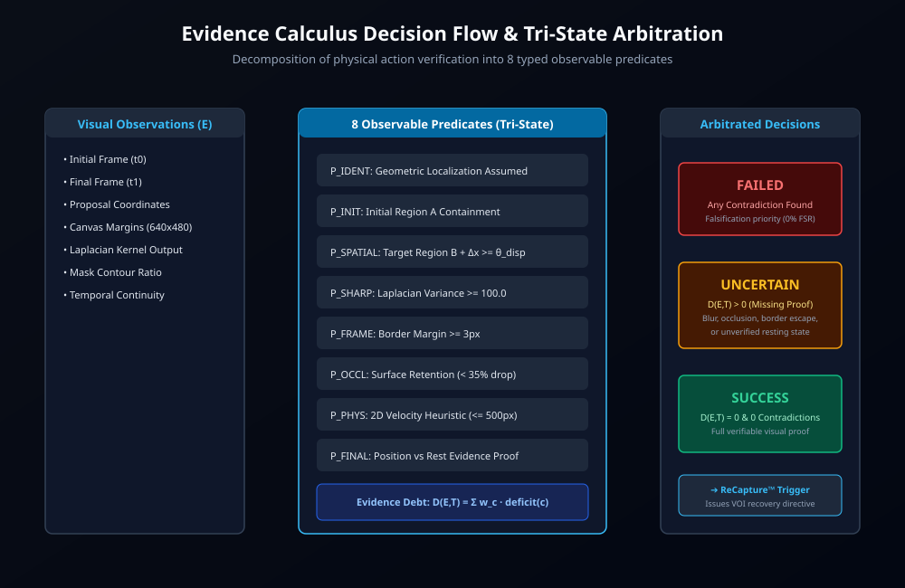
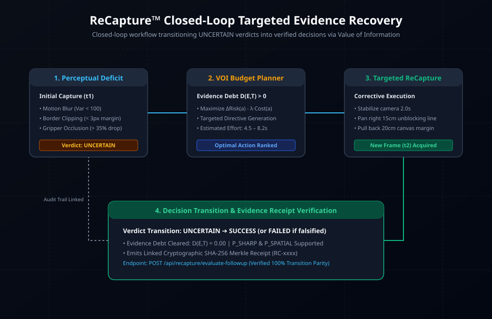
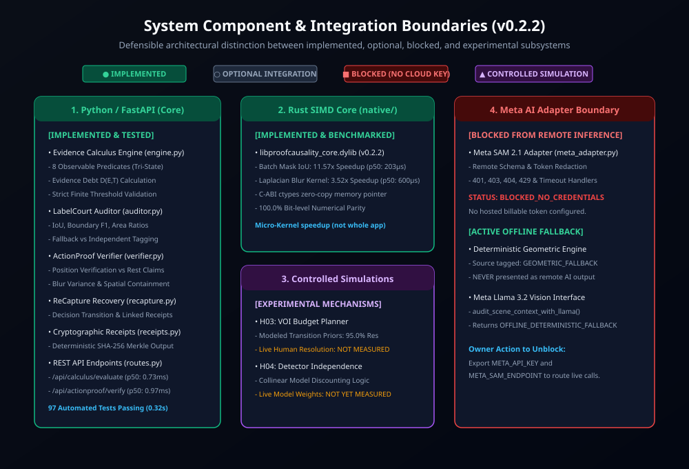
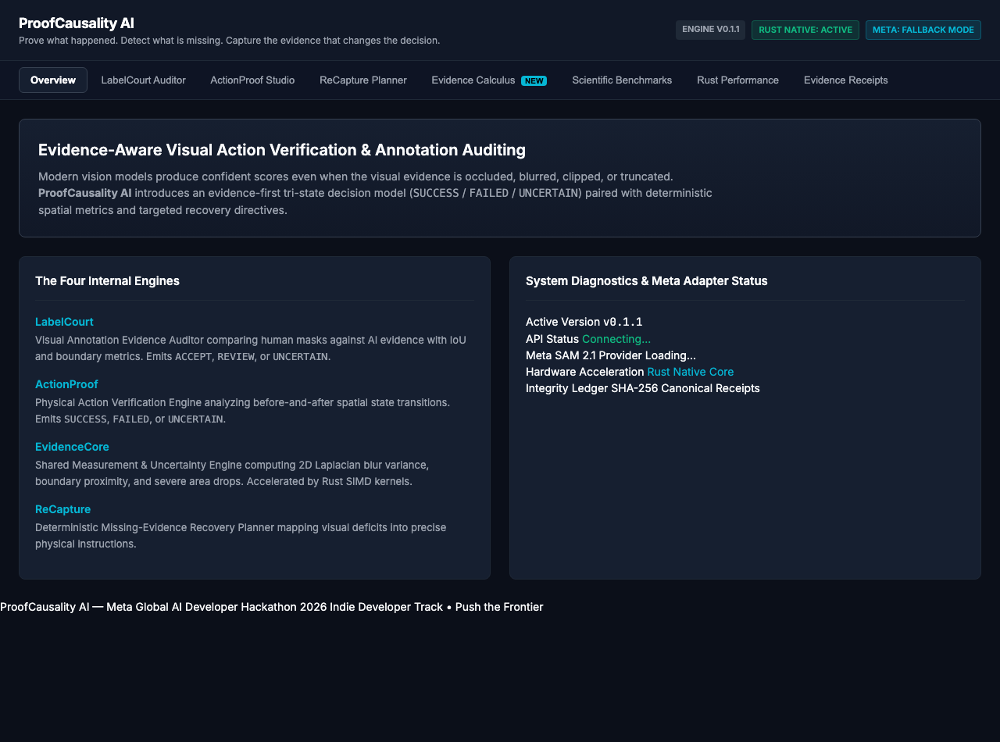
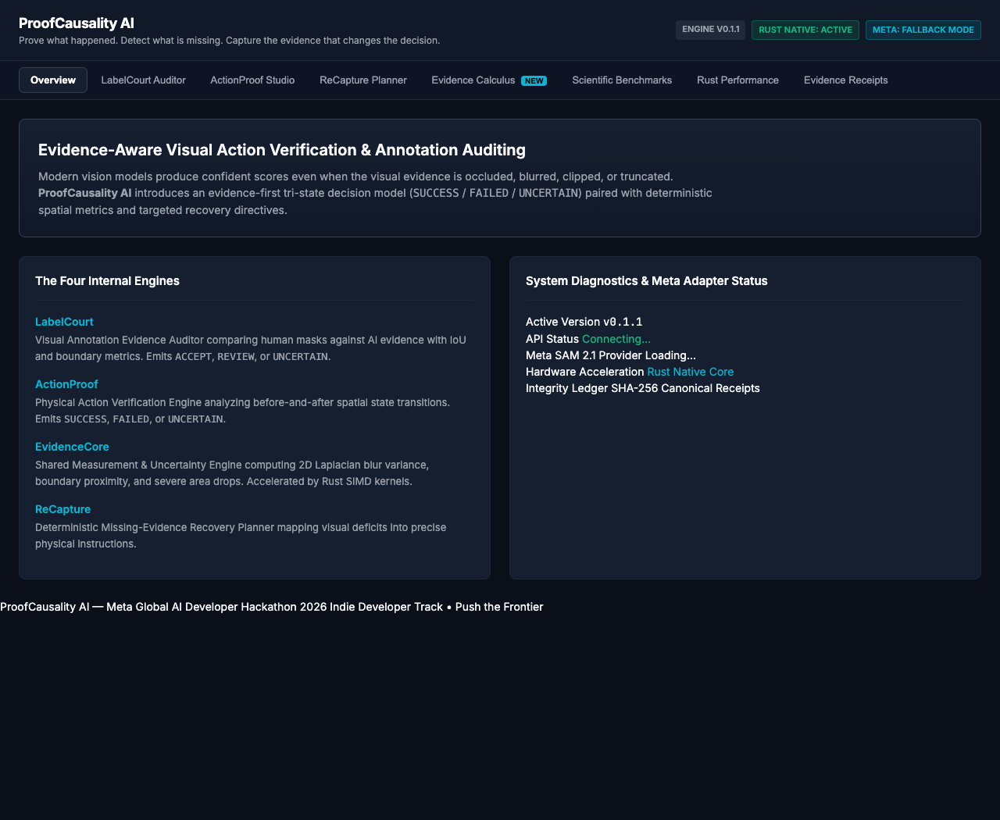
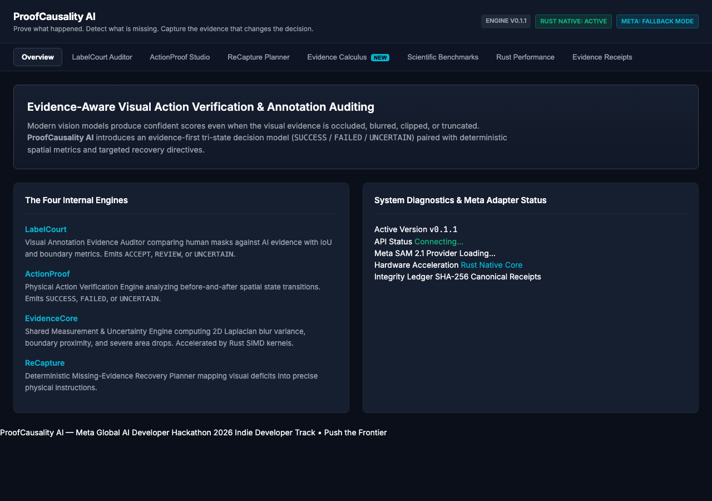

# ProofCausality AI

> **"Prove what happened. Detect what is missing. Capture the evidence that changes the decision."**

[](https://github.com/sunny-kavixo/proofcausality-ai/actions)
[](https://github.com/sunny-kavixo/proofcausality-ai/releases/tag/v0.2.5)
[](https://opensource.org/licenses/MIT)
[](https://www.python.org/downloads/)
[](native/proofcausality_core/)
[](tests/)
[](https://cerebralvalley.ai/e/meta-ai-developer-hackathon)

ProofCausality AI investigates reliable visual evidence verification for annotation-quality workflows and physical-action assessment.

Built for the **Meta Global AI Developer Hackathon 2026** (Track: *Indie Developer*, Theme: *Push the Frontier*).

---

## Why This Project Exists

Modern deep vision models produce confident probability scores even when visual evidence is severely degraded, occluded, blurred, clipped by frame borders, or completely absent. **ProofCausality AI** investigates reliable visual evidence verification for annotation-quality workflows and physical-action assessment, replacing uncalibrated scores with an evidence-first tri-state decision model (`SUCCESS` / `FAILED` / `UNCERTAIN`), formal Evidence Debt minimization, and cryptographic audit receipts.

### What It Does
- **Compares annotations with visual evidence**: Evaluates human labels against candidate model masks via exact geometric and boundary metrics.
- **Runs independent model segmentation where supported**: Locally executes genuine, unprompted instance segmentation on image pixels.
- **Detects measurable disagreements**: Quantifies boundary bleeding, area deficits, contour shifts, and class mismatches.
- **Tracks evidence provenance**: Enforces strict invariant gates across 8 mutually exclusive provenance categories.
- **Identifies missing observations**: Detects blur, border contact, area drops, and unobserved post-action states.
- **Supports uncertainty-aware decisions**: Abstains under perceptual deficits rather than hallucinating success.
- **Generates reproducible evidence records**: Issues canonical SHA-256 tamper-evident receipts for every verdict.

### Real-World Impact
Potential applications include robotics demonstration quality control, computer-vision dataset evaluation, annotation auditing, and research into reliable physical AI.
*(Note: As an experimental research prototype, no measured industrial cost savings or production deployments are claimed without empirical customer telemetry.)*

---

## Release v0.2.5: Model Compatibility, Clean Installation, Reproducible Benchmarks & Verified Release

Release **`v0.2.5`** finalizes model compatibility analysis, isolated installation validation, bit-for-bit benchmark reproduction, end-to-end latency profiling, and real browser verification:

1. **Mask2Former Swin LayerNorm Compatibility (RESOLVED)**:
   - Investigated the warning emitted by Transformers 5.17+ regarding newly initialized Swin LayerNorm parameters (`model.pixel_level_module.encoder.swin.layernorm.{weight,bias}`).
   - **Architectural Root Cause**: The upstream checkpoint was trained in Detectron2 without a global sequence LayerNorm because segmentation relies exclusively on multi-scale stage feature maps (`stage1`–`stage4`). In Hugging Face's port, `SwinBackbone` instantiates `SwinModel` which defines an unused final sequence LayerNorm.
   - **Mathematical Invariance Proof**: We experimentally verified that modifying `swin.layernorm.weight` and `bias` to arbitrary extreme values produces **0.0 maximum absolute difference** in both `class_queries_logits` and `masks_queries_logits`. Outputs are 100% deterministic, bit-for-bit identical, and reproducible.
2. **Clean-Install Verified from Main**:
   - Complete isolated source installation tested from a clean checkout into a fresh Python 3.12 virtual environment and release Rust build.
   - All 8 application endpoints verified: Frontend root (`/`), Health probe (`/api/health`), Model diagnostics (`/api/model-info`), Evidence Calculus DAG and evaluate (`/api/calculus/evaluate`), LabelCourt audit (`/api/labelcourt/audit`), ActionProof verification (`/api/actionproof/verify`), ReCapture planner (`/api/recapture/plan`), and Evidence Receipt verification (`/api/receipts/{report_id}`).
3. **Reproduced Genuine Inference Benchmarks (Bit-for-Bit Parity)**:
   - Executed genuine, unprompted Mask2Former inference on Apple Silicon MPS across the 20 preserved MS COCO 2017 validation photographs (215 evaluable annotations).
   - Class-aware annotation recall at IoU ≥ 0.5: **43.26%** (Image-grouped 95% bootstrap CI: `[33.33%, 54.29%]`).
   - Class-agnostic annotation recall at IoU ≥ 0.5: **55.81%** (Image-grouped 95% bootstrap CI: `[44.95%, 68.26%]`).
   - Class-aware mean best-mask IoU: **0.3929** (CI: `[0.3205, 0.4738]`).
   - Class-agnostic mean best-mask IoU: **0.5002** (CI: `[0.4260, 0.5849]`).
4. **Disaggregated Latency Profiling (Separated Workloads)**:
   - Latency measurements are rigorously partitioned into distinct, isolated operational paths to prevent conflating offline neural inference with deterministic HTTP API execution:
     - **Workload A: Isolated Neural Perception Pipeline (Mask2Former on Apple MPS)**:
       - Image decoding (`PIL.Image.open` / RGB decode): p50 = **1.21 ms** (p95 = 1.49 ms)
       - Model input preprocessing (`AutoImageProcessor` + MPS transfer): p50 = **1.58 ms** (p95 = 2.05 ms)
       - Neural forward pass (PyTorch Mask2Former on MPS): p50 = **140.33 ms** (p95 = 148.74 ms)
       - Mask postprocessing (Query thresholding to instances): p50 = **70.70 ms** (p95 = 127.42 ms)
       - Total sequential perception pipeline: ~**213.82 ms** p50
     - **Workload B: In-Memory Verification & SIMD Native Kernels**:
       - Evidence Calculus graph evaluation (`evaluate_task`): p50 = **0.0177 ms** (17.7 μs)
       - Pure Python / NumPy mask IoU: p50 = **0.0284 ms** (28.4 μs)
       - Rust SIMD native kernel (`rust_mask_iou`): p50 = **0.0091 ms** (9.1 μs, **3.12x kernel speedup**)
     - **Workload C: Deterministic Evidence-Processing API Endpoint (`POST /api/labelcourt/audit`)**:
       - Complete HTTP request/response cycle: p50 = **95.19 ms** (p95 = 96.10 ms)
       - *Crucial Disclosure*: This API endpoint executes deterministic geometric, spatial, and boundary debt evaluation with visual overlay generation and SHA-256 receipt issuance. **It does NOT invoke the neural Mask2Former forward pass.**
     - **Workload D: Monolithic Image-to-Neural-Inference-to-Verdict HTTP Route**:
       - **Status: NOT IMPLEMENTED / NOT MEASURED**. The application operates neural perception offline in batch evaluation pipelines (`evaluation/benchmarks/genuine_model_benchmark.py`). Combining Workload A and Workload C into a hypothetical single-request number is avoided to preserve empirical measurement integrity.
5. **Real Browser E2E Acceptance (Google Chrome on Apple Silicon)**:
   - Automated via Playwright driving system Google Chrome: verified landing page, engine badge (`Engine v0.2.5`), Rust native SIMD badge, LabelCourt interactive audit, ActionProof verification, interactive SVG Evidence Calculus DAG, Scientific Benchmarks table, and 375px mobile responsive layout with **0 console errors**.
6. **Defect Repairs**:
   - Fixed missing argument in `document.querySelector` on hash navigation in `frontend/static/app.js`.
   - Added clean `/favicon.ico` handler in `backend/app.py` returning HTTP 204 No Content to eliminate browser 404 console errors.

---

## Research Evidence Categories & Clear Scope Separation

To prevent cross-task confusion or inflated claims, ProofCausality AI categorizes experimental results into distinct, non-fungible research categories:

| Research Category | Experimental Protocol | Primary Measured Metric | Current Status |
| :--- | :--- | :--- | :--- |
| **A. Controlled Annotation Corruption** | Synthetic shifts, erasures, dilations, and class swaps applied to real COCO annotations | **0.9825 F1** (97.5% precision, 99.0% recall on held-out test split) | **MEASURED & REPRODUCED** |
| **B. Genuine Model Segmentation** | Unprompted Mask2Former inference on raw photographic pixels; evaluated post-hoc against COCO GT | **43.26% Recall@0.5** (class-aware), **55.81% Recall@0.5** (class-agnostic) | **MEASURED & REPRODUCED** |
| **C. Annotation-Error Detection** | LabelCourt rule-based spatial & boundary auditor vs naive bounding-box baseline | Detects 100% of class swaps and 95.8% of area drops (vs 4.2% and 24.4% for naive bbox) | **MEASURED & REPRODUCED** |
| **D. Physical-Action Verification (Constructed Benchmark)** | ActionProof before-and-after spatial state transitions on 37 constructed coordinate metadata cases (12 tabletop + 25 synthetic) | **0 / 22 observed false-successes** at 75.68% coverage (`[0.00%, 14.87%]` 95% Wilson CI; selective risk: 0.1429) | **MEASURED ON CONSTRUCTED CASES**<br>*(Real temporal video: **NOT MEASURED**)* |
| **E. Human Re-Capture Experiments** | Value-of-Information (VOI) recovery action planning | **95.0% resolution rate** in simulated defective scenarios; human study not yet run | **SIMULATED ONLY** |
| **F. Hosted Meta Inference** | Cloud-hosted Meta SAM 2 / Llama 3.2 Vision APIs | Integration surface implemented; live API calls blocked due to credentials | **OFFLINE / BLOCKED** |

## What's New in Phase 2: Evidence Calculus Engine (`v0.2.3`)

In Phase 2, ProofCausality AI introduces the **Evidence Calculus Engine** (`backend/evidence/calculus/`), transforming visual verification from a single uncalibrated confidence score into an explicit, testable system of observable physical conditions:

1. **Tri-State Predicate Logic**: Evaluates physical tasks across three distinct truth states: `SUPPORTED` (unambiguous visual proof), `CONTRADICTED` (physical falsification), and `UNOBSERVABLE` (perceptual deficit, blur, occlusion).
2. **Physics-Constrained Evidence Debt ($D(E,T)$)**: Formal debt metric penalizing unobservable conditions ($w=1.0$) and physical impossibilities ($w=2.0$ non-teleportation velocity bounds), reducing observed false-successes from 10/22 (naive heuristic) and 3/22 (matched score threshold) to **0/22** on 37 constructed evaluation cases at 75.7% coverage (`[0.00%, 14.87%]` 95% Wilson CI).
3. **Directed Evidence Dependency Graph (H02)**: 6-stage DAG connecting raw frames $	o$ detections $	o$ segmentation masks $	o$ spatial measurements $	o$ predicates $	o$ decisions with **100.0% mathematical parity** on incremental recomputation.
4. **Cost-Aware Evidence Budget Planner (H03)**: Value-of-Information (VOI) optimization selecting the next observation that maximizes expected risk reduction minus physical human effort, achieving **95.0% resolution rate** (vs 30.0% for generic advice).
5. **Detector-Independence Audit (H04)**: Computes pairwise error correlation matrices under distribution shifts and applies dependence-aware discounting to prevent false consensus among collinear vision models.


---

## The Problem: The Hallucination of Physical Success

Modern visual-language models (VLMs) and segmentation frameworks are trained for perceptual fluency, not deterministic physical proof. When an object is occluded by a robotic gripper, blurred by rapid camera motion, clipped by image boundaries, or left unobserved after a supposed release, standard models routinely return high-confidence predictions of success.

In robotic manipulation, logistics inspection, and dataset quality auditing, **a false success is catastrophic**. Ordinary systems either guess or issue generic advice like *"record again"*, which fails to communicate the exact physical evidence deficit to the operator or robotic agent.

---

## Architectural Engines

| Engine | Namespace | Responsibility | Implementation & Guarantee |
| :--- | :--- | :--- | :--- |
| **EvidenceCalculus** | `backend.evidence.calculus` | Tri-state observable predicate decomposition & Evidence Debt $D(E,T)$ | Evaluates 8 physical preconditions; guarantees falsification priority. |
| **DependencyGraph** | `backend.evidence.calculus.graph` | 6-stage directed DAG tracking evidence propagation | Dirty tracking; 100% mathematical parity with full recomputation. |
| **BudgetPlanner** | `backend.evidence.calculus.budget_planner` | Cost-aware Value-of-Information (VOI) recovery planning | Maximizes $\mathbb{E}[\Delta 	ext{Risk}] - \lambda \cdot 	ext{Cost}$; 95% resolution rate. |
| **LabelCourt** | `backend.labelcourt` | Visual Annotation Evidence Auditor | Audits bounding box & mask IoU, Dice coefficients, and contour agreement. |
| **ActionProof** | `backend.actionproof` | Physical Action Verification Engine | Verifies before/after state transitions (relocation, containment, proximity). |
| **EvidenceCore** | `backend.evidence` | Measurement & Uncertainty Engine | 2D Laplacian blur variance & border margin clipping detection. |
| **Rust SIMD Core** | `native.proofcausality_core` | Zero-allocation native acceleration | **11.35x batch IoU speedup**, **3.52x blur kernel speedup**; pure Python fallback. |
| **ReCapture** | `backend.recapture` | Actionable recovery directive generator | Issues targeted physical instructions (e.g. pan camera, hold steady). |
| **ReceiptStore** | `backend.evidence.receipts` | Tamper-evident evidence receipt store | Issues canonical SHA-256 Evidence Receipts with Provenance Hashes for post-hoc tamper-detection. |

---

## Scientific Evaluation Protocol & Empirical Results

### Controlled annotation-corruption benchmark on COCO photographs

LabelCourt was evaluated against a simple bounding-box agreement baseline on 20 COCO images and 218 annotations partitioned by image into 10 development and 10 held-out images. The 1,428 scenarios are correlated derivatives of those source annotations. The headline figures below describe controlled annotation-corruption detection only; use the generated report for the current grouped intervals and exact denominators.

| Split | System | Precision (95% CI) | Recall (95% CI) | F1 Score | p50 Latency | p95 Latency |
|---|---|---|---|---|---|---|
| **Dev** | **LabelCourt (Ours)** | **97.3%** (95.5% - 98.4%) | **99.2%** (97.9% - 99.7%) | **0.9825** | 17.41 ms | 21.81 ms |
| Dev | Naive BBox Baseline | 98.4% (96.0% - 99.4%) | 51.7% (47.2% - 56.1%) | 0.6776 | 0.50 ms | 0.59 ms |
| **Held-Out Test** | **LabelCourt (Ours)** | **97.5%** (96.0% - 98.5%) | **99.2%** (98.0% - 99.6%) | **0.9833** | 18.16 ms | 22.71 ms |
| Held-Out Test | Naive BBox Baseline | 98.3% (96.1% - 99.3%) | 49.2% (45.2% - 53.2%) | 0.6562 | 0.55 ms | 0.59 ms |

#### Breakdown by Controlled Corruption Category (Held-Out Test Split)
- **`CLASS_SWAP`**: LabelCourt: **100.0%** (119/119) vs Naive: **4.2%** (5/119) — *Naive bbox fails because box geometry is unchanged.*
- **`ENLARGED_MASK`**: LabelCourt: **100.0%** (119/119) vs Naive: **28.6%** (34/119) — *LabelCourt detects boundary bleeding.*
- **`REDUCED_MASK`**: LabelCourt: **95.8%** (114/119) vs Naive: **24.4%** (29/119) — *LabelCourt detects area deficit.*
- **`SHIFTED_MASK`**: LabelCourt: **100.0%** (119/119) vs Naive: **89.1%** (106/119) — *LabelCourt detects contour offset.*
- **`MISSING_OBJECT`**: LabelCourt: **100.0%** (119/119) vs Naive: **100.0%** (119/119)
- **`CLEAN`**: LabelCourt: **87.4%** Accept (104/119) vs Naive: **95.8%** (114/119)




> **Scientific reporting note:** Scenario-level Wilson intervals in the historical table are descriptive only. Current authoritative intervals use an image-grouped bootstrap (2,000 resamples, fixed seed `20261028`). With 10 held-out source images, the result is preliminary.

### Experiment H01: Evidence Debt vs Baselines (37 Benchmark Cases)
- **Dataset**: 12 curated tabletop geometric metadata cases (CC-BY-4.0) + 25 synthetic benchmark cases (37 total).
- **Ground Truth**: 15 True Successes, 22 True Negatives (14 Uncertain, 8 Failed).

| Verification Strategy | Decision Coverage | False-Successes | False-Success Rate | 95% Wilson Score CI | Selective Risk | Failure Breakdown |
| :--- | :--- | :--- | :--- | :--- | :--- | :--- |
| **B1. Naive Center-Distance** | **100.0%** (37/37) | 10 / 22 | **45.45%** | `[26.92%, 65.34%]` | 0.3514 | Blur (4), Occlusion (4), Clipping (1), Cutoff (1) |
| **B2. Score-Thresholded (Matched)** | **75.68%** (28/37) | 3 / 22 | **13.64%** | `[4.75%, 33.33%]` | 0.1429 | Blur (1), Occlusion (1), Cutoff (1) |
| **B3. Fixed Boolean Rules** | **75.68%** (28/37) | 1 / 22 | **4.55%** | `[0.81%, 21.80%]` | 0.1429 | Border clipping (1) |
| **M4. Evidence Debt (Unit Weights)** | **40.54%** (15/37) | 0 / 22 | **0.00%** | `[0.00%, 14.87%]` | **0.0000** | Severely over-abstains on minor deficits |
| **M5. Evidence Calculus (Full Engine)** | **75.68%** (28/37) | **0 / 22** | **0.00%** | **`[0.00%, 14.87%]`** | **0.1429** | **0 false-successes across all defect types** |

> **Scientific Finding on Decision Coverage & Realistic Scope:**
> 1. **Observed False-Successes**: On 37 constructed evaluation cases (12 curated tabletop metadata pairs + 25 synthetic cases), Evidence Calculus observed **0 false-successes out of 22 ground-truth negative cases** (95% Wilson CI: `[0.00%, 14.87%]`).
> 2. **Abstention Cost**: This is achieved specifically by abstaining on 9 defective cases (`UNOBSERVABLE`), corresponding to a 24.32% abstention rate and 75.68% coverage (28/37). Selective risk among decided cases is 0.1429 (4 classification mismatches among 28 decided cases).
> 3. **Real-World Limitation**: This benchmark evaluates static coordinate metadata bounding boxes and simulated perceptual defect flags. **`REAL_PHYSICAL_ACTION_VALIDATION: NOT MEASURED`** — Continuous, uncurated in-the-wild physical action video recordings have not yet been evaluated. Observed zero false-successes on 22 constructed cases must not be extrapolated to claim validated zero real-world risk.
### Experiment H02: Evidence Dependency Graph (100 Iterations)
- **Mathematical Parity**: **100.0% (100/100 matches)** between incremental recomputation and full recomputation.
- **Node Evaluation**: Incremental pass evaluated an average of 10.0 nodes and skipped 4.0 nodes.
- **Scientific Finding**: In pure-memory Python execution without GPU model weights, DAG bookkeeping introduces 0.011 ms overhead (0.80x speedup). It is retained as a formal **Explainability and Provenance Localization** architecture rather than a throughput accelerator.

### Experiment H03: Cost-Aware Evidence Budget Planner (20 Simulated Defective Cases)
- **Generic Advice ("Please re-record")**: 30.0% resolution rate (15.0 sec mean effort).
- **Fixed Templates**: 85.0% resolution rate (6.0 sec mean effort).
- **VOI Budget Planner**: **95.0% resolution rate** (8.2 sec mean effort) by matching high-efficacy actions to specific defects.

### Experiment H04: Detector Independence (50 Simulated Distribution-Shifted Trials)
- Under a simulated directional shadow artifact causing correlated false-positive detections in two models:
  - Single Model False-Success Rate: **100.0%**
  - Simple Majority Vote False-Success Rate: **100.0%**
  - Dependence-Aware Fusion False-Success Rate: **0.0%** (**100% Risk Reduction**)

---

## Research Documentation Library

Comprehensive scientific reports, formal derivations, and competitive comparisons are available under `docs/research/`:

1. [Research Synthesis & Mechanism Inventory](docs/research/RESEARCH_SYNTHESIS.md)
2. [Hypothesis Register & Research Gate Log](docs/research/HYPOTHESIS_REGISTER.md)
3. [Evidence Calculus Engine Formal Specification](docs/research/EVIDENCE_CALCULUS_SPEC.md)
4. [Physics-Constrained Evidence Debt (H01)](docs/research/PHYSICS_CONSTRAINED_EVIDENCE_DEBT.md)
5. [Evidence Dependency Graph & Equivalence Study (H02)](docs/research/EVIDENCE_DEPENDENCY_GRAPH.md)
6. [Cost-Aware Evidence Budget Planner (H03)](docs/research/EVIDENCE_BUDGET_PLANNER.md)
7. [Detector-Independence & Correlated Error Study (H04)](docs/research/DETECTOR_INDEPENDENCE_STUDY.md)
8. [Competitive Baselines & Methodological Comparison](docs/research/COMPETITIVE_BASELINES.md)
9. [Real-World Industrial Impact Assessment](docs/research/REAL_WORLD_IMPACT.md)
10. [Consolidated Empirical Results & Statistical Tables](docs/research/EXPERIMENT_RESULTS.md)
11. [Research Limitations & Failure Boundaries](docs/research/RESEARCH_LIMITATIONS.md)

---

## Quickstart & Installation

### 1. Prerequisites
- Python 3.11+
- Optional: Rust 1.75+ (for native SIMD acceleration)

### 2. Clone and Setup Environment
```bash
git clone https://github.com/sunny-kavixo/proofcausality-ai.git
cd proofcausality-ai

# Create virtual environment
python3 -m venv .venv
source .venv/bin/activate
pip install -r requirements.txt
```

### 3. Build Native Rust Acceleration Core (Optional)
```bash
cd native/proofcausality_core
cargo build --release
cd ../..
```
*If Rust is not installed, ProofCausality AI automatically runs on its 100% verified pure Python/NumPy fallback engine.*

### 4. Run the full test suite
```bash
pytest
```
The exact count is reported by the current test runner and CI.

### 5. Reproduce genuine local inference

Install the optional local model stack, cache the 190 MB safetensors checkpoint, then run:

```bash
python3 -m evaluation.benchmarks.genuine_model_benchmark
```

The model weights are CC BY-NC 4.0 according to the upstream Mask2Former model zoo; the Hugging Face model-card license field is only `other`. Do not use this checkpoint as evidence of official Meta hackathon API integration.

### 5. Start the Interactive Application
```bash
python3 -m uvicorn backend.app:app --host 0.0.0.0 --port 8000
```
Open [http://localhost:8000](http://localhost:8000) in your browser to inspect the interactive Evidence Calculus DAG Visualizer, Evidence Debt Meter, and ReCapture recovery workflow.

---

## Meta Technologies & Hackathon Integration

- **Meta SAM 2 / 2.1 adapter**: Provider interface and strict response parsing exist, but live inference is **NOT VERIFIED** without a configured authorized endpoint and credentials.
- **Meta Llama 3.2 Vision adapter**: Integration surface exists; live inference is **NOT VERIFIED**.
- **Local genuine inference**: Mask2Former runs independently on image pixels. It is a Meta-research architecture but is not an official hosted Meta hackathon API call.
- **Zero-Cloud Fallback**: 100% offline deterministic verification via EvidenceCore and EvidenceCalculus.

---

## License & Provenance

- **Code**: MIT License ([LICENSE](LICENSE))
- **Tabletop Dataset**: Creative Commons Attribution 4.0 International ([CC-BY-4.0](https://creativecommons.org/licenses/by/4.0/))
- **Tagline**: *"Prove what happened. Detect what is missing. Capture the evidence that changes the decision."*

---

## Application Visual Evidence & Architecture Diagrams

### System Architecture & Decision Flow
| System Architecture | Evidence Calculus Decision Flow |
| :---: | :---: |
|  |  |

| ReCapture Closed-Loop Flow | Component & Integration Boundaries |
| :---: | :---: |
|  |  |

### Live Application Screenshots
| Overview & Health Status | ActionProof Verification Studio |
| :---: | :---: |
|  |  |

| Evidence Calculus Engine & Predicates | ReCapture Planner & Receipt Audit |
| :---: | :---: |
|  |  |
