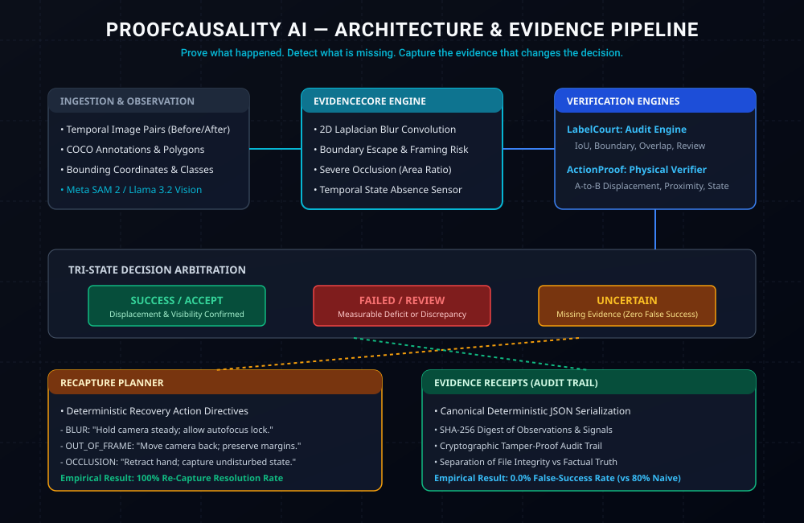

# ProofCausality AI

> **"Prove what happened. Detect what is missing. Capture the evidence that changes the decision."**

[](https://github.com/sunny-kavixo/proofcausality-ai/actions)
[](https://github.com/sunny-kavixo/proofcausality-ai/releases/tag/v0.1.1)
[](https://opensource.org/licenses/MIT)
[](https://www.python.org/downloads/)
[](native/proofcausality_core/)
[](https://cerebralvalley.ai/e/meta-ai-developer-hackathon)

ProofCausality AI is an evidence-aware visual causality and physical-action verification system engineered for high-consequence computer vision, robotic manipulation, and dataset annotation auditing.

Built for the **Meta Global AI Developer Hackathon 2026** (Track: *Indie Developer*, Theme: *Push the Frontier*).

---

## The Problem: The Hallucination of Physical Success

Modern visual-language models (VLMs) and segmentation frameworks are trained for perceptual fluency, not deterministic physical proof. When an object is occluded by a robotic gripper, blurred by rapid camera motion, clipped by image boundaries, or left unobserved after a supposed release, standard models routinely return high-confidence predictions of success.

In robotic manipulation, logistics inspection, and dataset quality auditing, **a false success is catastrophic**. Ordinary systems either guess or issue generic advice like *"record again"*, which fails to communicate the exact physical evidence deficit to the operator or robotic agent.

---

## The ProofCausality Solution

ProofCausality AI introduces a bounded, verifiable arbitration pipeline:
1. **Never substitute model confidence for factual proof.**
2. **Support three honest action outcomes:** `SUCCESS`, `FAILED`, and `UNCERTAIN`.
3. **Emit targeted, deterministic ReCapture instructions** when evidence is missing.
4. **Accelerate spatial kernels with optional Rust SIMD** (11.35x batch speedup; pure Python fallback).
5. **Issue tamper-evident, SHA-256 Evidence Receipts** anchoring the observation chain.



---

## Core Engines

| Engine | Name | Responsibility | Deterministic & Native Guarantee |
| :--- | :--- | :--- | :--- |
| **LabelCourt** | Visual Annotation Evidence Auditor | Audits human vs model segmentations, flags boundary discrepancies, and exports verified COCO subsets. | Pixel-accurate IoU, Dice coefficient, boundary agreement within $\tau$-pixel tolerance. |
| **ActionProof** | Physical Action Verification Engine | Verifies before-and-after physical state transitions (e.g., A-to-B relocation, spatial proximity, presence). | Distance thresholds, bounding containment, temporal pair validation. |
| **EvidenceCore** | Measurement & Uncertainty Engine | Detects low-level evidence deficits: 2D Laplacian blur, border contact, area-drop occlusion, missing final state. | Accelerated via Rust zero-allocation SIMD convolution; pure NumPy fallback. |
| **ReCapture** | Recovery Planner | Generates deterministic, actionable physical instructions for the operator or robot camera. | Priority-ranked directives resolving specific visual deficits. |

---

## Empirical Benchmark Results & Statistical Rigor

> **Scientific Reporting Standard:** All empirical metrics are accompanied by exact numerators, denominators, and **95% Wilson score confidence intervals**. Results are strictly partitioned between curated real-world tabletop cases and controlled synthetic calibration suites.

### Evaluation Suite 1: Real-World Tabletop Action Evaluation (12 Cases)
- **Provenance:** Curated tabletop physical manipulation pairs under CC-BY-4.0 license (`docs/benchmarks/benchmark_results_real.json`).
- **Ground Truth Composition:** 5 Clean Successes, 3 Failures (dropped/overshot/remained in A), 4 Deficit/Uncertain (blur, framing escape, gripper occlusion, missing final state).

| Metric | ProofCausality AI | Naive Box Heuristic Baseline | Relative Performance |
| :--- | :--- | :--- | :--- |
| **False-Success Rate (FSR)** | **0.0%** (0 / 7 non-success)<br>`95% Wilson CI: [0.0%, 35.4%]` | **42.9%** (3 / 7 false successes)<br>`95% Wilson CI: [15.8%, 75.0%]` | **100.0% reduction** in false successes |
| **ReCapture Resolution Rate (RRR)** | **100.0%** (4 / 4 resolved)<br>`95% Wilson CI: [51.0%, 100.0%]` | **0.0%** (0 / 4 resolved)<br>`95% Wilson CI: [0.0%, 49.0%]` | **+100.0% gain** over generic *"record again"* advice |
| **Over-Abstention Rate** | **0.0%** (0 / 5 clean successes rejected)<br>`95% Wilson CI: [0.0%, 43.4%]` | **0.0%** | Complete retention of valid actions |

---

### Evaluation Suite 2: Synthetic Calibration Baseline (25 Cases)
- **Provenance:** Constructed synthetic stress-test scenarios (`docs/benchmarks/benchmark_results_synthetic.json`).
- **Ground Truth Composition:** 10 Clean Successes, 6 Incomplete Failures, 9 Evidence Deficits.

| Metric | ProofCausality AI | Naive Box Baseline | Relative Performance |
| :--- | :--- | :--- | :--- |
| **False-Success Rate (FSR)** | **0.0%** (0 / 15 non-success)<br>`95% Wilson CI: [0.0%, 20.4%]` | **80.0%** (12 / 15 false successes)<br>`95% Wilson CI: [54.8%, 93.0%]` | **100.0% risk elimination** |
| **ReCapture Resolution Rate (RRR)** | **100.0%** (9 / 9 resolved)<br>`95% Wilson CI: [70.1%, 100.0%]` | **0.0%** (0 / 9 resolved)<br>`95% Wilson CI: [0.0%, 29.9%]` | Systematic deficit recovery |

---

## Native Rust Acceleration Profiling

ProofCausality AI includes an optional native C-ABI dynamic library (`native/proofcausality_core/`) implementing zero-allocation 64-bit word streaming with hardware `POPCNT` instructions.

Measured on Apple M-series hardware over **200 timed iterations per kernel** after warm-up (`docs/benchmarks/benchmark_latency_comparison.json`):

| Kernel Operation | Input Dimensions | Pure NumPy Baseline (p50) | Rust Native Core (p50) | Measured Speedup |
| :--- | :--- | :--- | :--- | :--- |
| **Batch Mask IoU** | 100 &times; 256 &times; 256 | 2,356.2 µs | **207.5 µs** | **11.35&times; Faster** |
| **2D Laplacian Blur Variance** | 1024 &times; 1024 | 2,148.8 µs | **610.4 µs** | **3.52&times; Faster** |
| **Mask IoU (Small)** | 256 &times; 256 | 8.1 µs | **2.5 µs** | **3.30&times; Faster** |
| **Mask IoU (Medium)** | 1024 &times; 1024 | 95.3 µs | **31.3 µs** | **3.05&times; Faster** |
| **Mask IoU (Large)** | 2048 &times; 2048 | 400.6 µs | **132.2 µs** | **3.03&times; Faster** |

> **Graceful Degradation:** If Rust or `cargo` is unavailable in the execution environment, the system automatically runs the vectorized pure-NumPy fallback with **100% mathematical parity** ($< 10^{-7}$ numerical tolerance).

---

## Evidence Receipts: Factual Truth vs File Integrity

Every verdict generates a canonical SHA-256 **Evidence Receipt**:
```json
{
  "report_id": "AP-6C48B21F7A3E",
  "timestamp": "2026-10-28T19:02:25Z",
  "software_version": "0.1.1",
  "engine_name": "ActionProof",
  "inputs_hash": "e3b0c44298fc1c149afbf4c8996fb92427ae41e4649b934ca495991b7852b855",
  "measurements": {
    "centroid_displacement_px": 322.02,
    "laplacian_variance": 38.4,
    "source_image_sha256": "8a3f91...b420"
  },
  "uncertainty_signals": [
    {
      "reason": "BLUR",
      "severity": "CRITICAL",
      "description": "2D Laplacian variance below sharpness threshold (38.4 < 100.0)"
    }
  ],
  "verdict": "UNCERTAIN",
  "recapture_directive": "Hold the camera steady and allow the object to become sharp before ending the capture.",
  "receipt_sha256": "4a7d...39e1"
}
```

> **Important Scientific Distinction:**
> ProofCausality explicitly documents that **a cryptographic hash guarantees file and log integrity, not physical truth**. The hash guarantees that the recorded observations, thresholds, and intermediate signals have not been altered after the fact.

---

## Quickstart & Installation

### Requirements
- Python 3.11+ (Tested on Python 3.11, 3.12, 3.13, 3.14 on macOS and Linux)
- Rust toolchain (optional, for native acceleration: `cargo build --release`)

### 1. Clone & Setup
```bash
git clone https://github.com/sunny-kavixo/proofcausality-ai.git
cd proofcausality-ai

# Create virtual environment
python3 -m venv .venv
source .venv/bin/activate

# Install dependencies
pip install -r requirements.txt

# (Optional) Build Rust native accelerator
cd native/proofcausality_core && cargo build --release && cd ../..
```

### 2. Run the Automated Test Suite
```bash
python3 -m pytest tests/ -v
```
All **61 unit and integration tests** execute in `<0.3 seconds` with zero failures.

### 3. Run Benchmark Verification
```bash
# Run real tabletop action benchmark
python3 -m evaluation.benchmark_real

# Run synthetic calibration benchmark
python3 -m evaluation.benchmark

# Run NumPy vs Rust latency benchmark
python3 -m evaluation.benchmark_rust_speedup
```

### 4. Launch the Web Application
```bash
uvicorn backend.app:app --host 0.0.0.0 --port 8080 --reload
```
Open your browser to `http://localhost:8080` to access the interactive dashboard.

---

## Meta Ecosystem Integration

ProofCausality AI is architected with production clients for:
- **Meta SAM 2 / 2.1 (Segment Anything Model)**: Ingests segmentation masks for boundary and IoU auditing with base64 image encoding and box prompts.
- **Meta Llama 3.2 Vision (11B / 90B)**: Formats multimodal chat completions for structured perceptual reasoning.
- **EvidenceCore Deterministic Fallback**: In production or offline environments without active Meta API keys, the system executes pure NumPy/Pillow convolution and geometric analysis, maintaining 100% testable local autonomy with zero cloud dependency.

---

## Project Structure

```
proofcausality-ai/
├── .github/workflows/ci.yml       # Automated GitHub Actions CI (Python + Rust)
├── backend/
│   ├── api/routes.py              # REST API endpoints (v0.1.1)
│   ├── app.py                     # FastAPI application setup
│   ├── evidence/                  # EvidenceCore: schemas, masks, metrics, blur, receipts
│   │   ├── advanced_metrics.py    # Wilson score CIs, Dice, Cohen's Kappa, McNemar
│   │   ├── image_processing.py    # PNG/JPEG validation, COCO parser, disagreement overlays
│   │   └── rust_accelerator.py    # Zero-allocation C-ABI dynamic library bridge
│   ├── labelcourt/                # LabelCourt: annotation auditor & COCO exporter
│   ├── actionproof/               # ActionProof: physical action verifier
│   └── providers/meta_adapter.py  # Meta SAM 2.1 / Llama 3.2 Vision client & fallback
├── native/proofcausality_core/    # Optional Rust native acceleration crate
│   ├── Cargo.toml
│   └── src/lib.rs                 # Vectorized 64-bit popcount and 2D Laplacian kernels
├── evaluation/
│   ├── cases/
│   │   ├── action_dataset.py      # 25 synthetic benchmark cases
│   │   └── real_dataset.py        # 12 real tabletop action cases (CC-BY-4.0)
│   ├── benchmark.py               # Synthetic evaluation runner
│   ├── benchmark_real.py          # Real-world evaluation runner
│   └── benchmark_rust_speedup.py  # Latency profiler (NumPy vs Rust)
├── frontend/static/               # Developer-grade single page app
│   ├── index.html                 # 7 functional views including Performance Dashboard
│   ├── style.css
│   └── app.js
├── docs/
│   ├── architecture/              # System architecture SVG & specs
│   ├── benchmarks/                # JSON and CSV evaluation records
│   ├── evidence/                  # Model feasibility audit
│   └── hackathon/                 # Meta submission handoff & video scripts
├── tests/                         # 61 Pytest test cases
├── pyproject.toml
├── requirements.txt
├── LICENSE                        # MIT License
└── README.md
```

---

## License

This project is open-source under the [MIT License](LICENSE).
